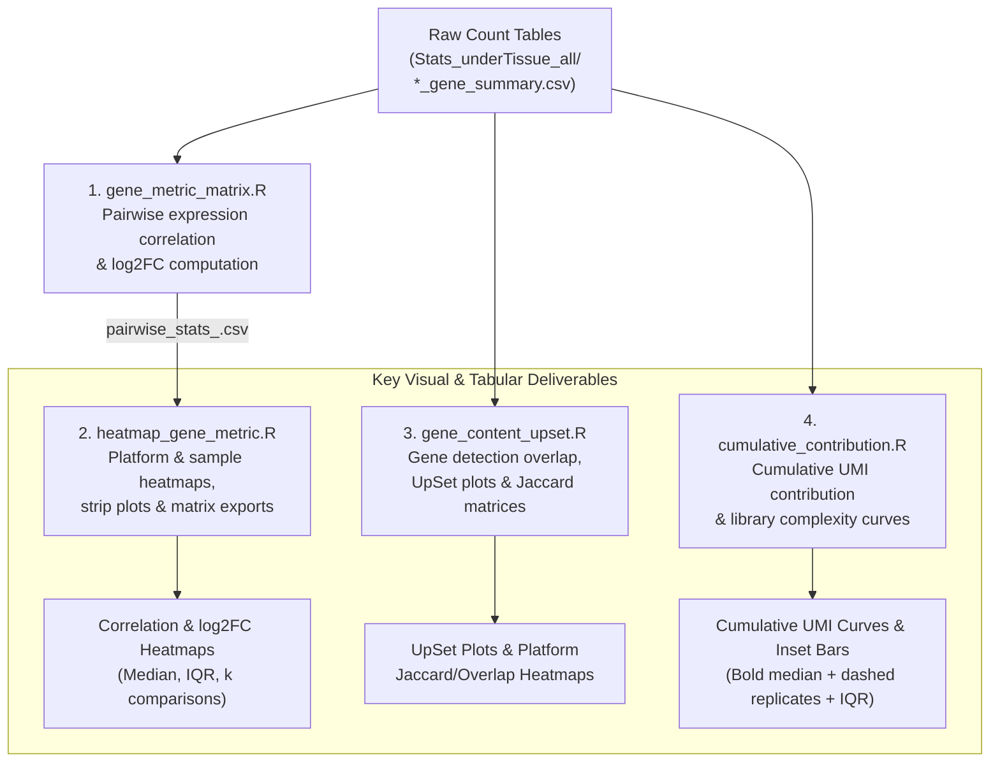

# Systematic_review_spatial_transcriptomics
This repository contains the used scripts for the analyses performed in the systematic review of sequencing-based spatial transcriptomics platforms.

## Part 1: Calculation & data-analysis of the normalized capture performance metric.

## Part 2: Calculation & data-analysis of the captured genes.

# Spatial Transcriptomics Benchmark Scripts Summary

This document provides a comprehensive overview of the four primary R scripts and their companion Slurm job submission wrappers developed for the spatial transcriptomics benchmark pipeline (`review_ST/Gene_metric`).

---

*1. Pipeline Overview & Script Roles*

---

*2. Master Summary Table*

| Script | Purpose & Scientific Question | Key CLI Arguments | Input Requirements | Main Output Figures (.png / .pdf) | Main Output Tables (.csv) | Companion Slurm Wrapper |
| :--- | :--- | :--- | :--- | :--- | :--- | :--- |
| **`gene_metric_matrix.R`** | Computes pairwise gene-by-gene expression correlation (Pearson raw, Pearson $\log_{10}$, Spearman) and fold changes ($\log_2\text{FC}$ median and IQR) across all sample pairs. Evaluates cross-platform reproducibility and concordance. | `--tissue_type` `--cor_scale` (`log10`, `spearman`, `raw`) `--common` (`pair`, `all`) `--scatter_mode` (`representative`, `overlay`, `none`) `--auto_heatmap` (`TRUE`/`FALSE`) `--subdivide_spots` (`auto`, `all`, `none`) | • `Stats_underTissue_all/*_gene_summary.csv` • `annotation_gene_metric.xlsx` | • `representative_scatter_<tissue>` • `representative_MA_<tissue>` • `gene_matrix_<tissue>` *(legacy overlay)* | • `pairwise_stats_<tissue>.csv` • `sample_summary_<tissue>.csv` | `submit_gene_metric.sh` |
| **`heatmap_gene_metric.R`** | Aggregates and visualizes pairwise correlation and log2FC matrices at platform and sample levels. Displays within-platform replicate concordance on the diagonal ($NA$ when $n=1$) and cross-platform comparisons off-diagonal. | `--input` (path to pairwise stats) `--tissue` `--cor_metric` (`log10`, `spearman`, `both`, `raw`) `--level` (`both`, `platform`, `sample`) `--cluster` (`TRUE`/`FALSE`) | • Output of `gene_metric_matrix.R` (`pairwise_stats_<tissue>.csv`) • Optional: `sample_summary_<tissue>.csv` | • `platform_heatmap_<cor_metric>_<tissue>` • `platform_heatmap_log2FC_<tissue>` • `strip_plot_<cor_metric>_<tissue>` • `sample_heatmap_<cor_metric>_<tissue>` | • `platform_matrix_<metric>_median_<tissue>.csv` • `platform_matrix_median_log2FC_<tissue>.csv` • `platform_matrix_IQR_log2FC_<tissue>.csv` | `submit_heatmap_gene_metric.sh` |
| **`gene_content_upset.R`** | Evaluates qualitative gene detection overlap and intersection size (recreation of Supplementary Fig S14). Features top $N$ / top $X\%$ expression ranking, UpSet intersection diagrams, and sample- and platform-level Jaccard and Overlap coefficient heatmaps. | `--tissue_type` `--top_n` *(e.g. 100, 200)* `--top_pct` *(e.g. 5, 0.1)* `--nintersects` *(default 5)* `--min_umis` *(default 1)* `--min_spots` *(default 1)* `--subdivide_spots` (`auto`) | • `Stats_underTissue_all/*_gene_summary.csv` • `annotation_gene_metric.xlsx` | • `upset_<tissue>[_filter]` • `jaccard_heatmap_<tissue>[_filter]` • `overlap_heatmap_<tissue>[_filter]` • `jaccard_platform_heatmap_<tissue>[_filter]` • `overlap_platform_heatmap_<tissue>[_filter]` | • `pairwise_set_similarity_<tissue>[_filter].csv` • `jaccard_platform_summary_<tissue>[_filter].csv` | `submit_gene_content.sh` |
| **`cumulative_contribution.R`** | Analyzes the cumulative contribution of genes to total UMI recovery (recreation of Supplementary Fig S15). Measures dynamic range, library composition, and capture complexity across Panel A (all genes), Panel B (common genes), and Panel C (non-common genes). | `--tissue_type` `--common_fraction` *(default 1.0; 0.8 recommended)* `--min_umis` `--min_spots` `--subdivide_spots` (`auto`) `--fig_width` *(default 12)* `--fig_height` *(default 5.0)* | • `Stats_underTissue_all/*_gene_summary.csv` • `annotation_gene_metric.xlsx` | • `cumulative_contribution_<tissue>` *(Bold platform median curve + faint dashed replicate lines + inset bars showing median detected genes with IQR whiskers)* | • `platform_gene_set_summary_<tissue>.csv` • `gene_set_summary_<tissue>.csv` • `common_genes_<tissue>.csv` | `submit_cumulative_contribution.sh` |

---

